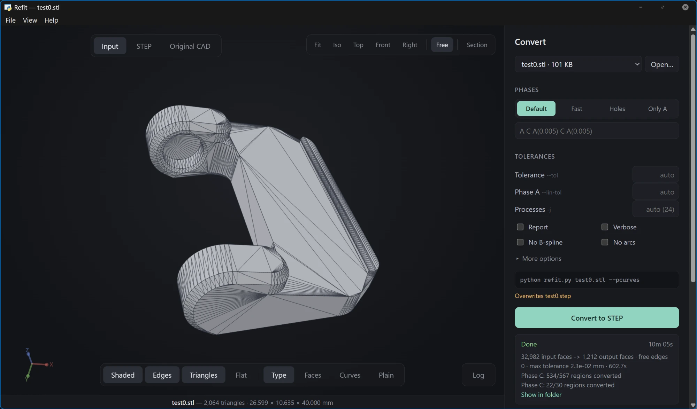
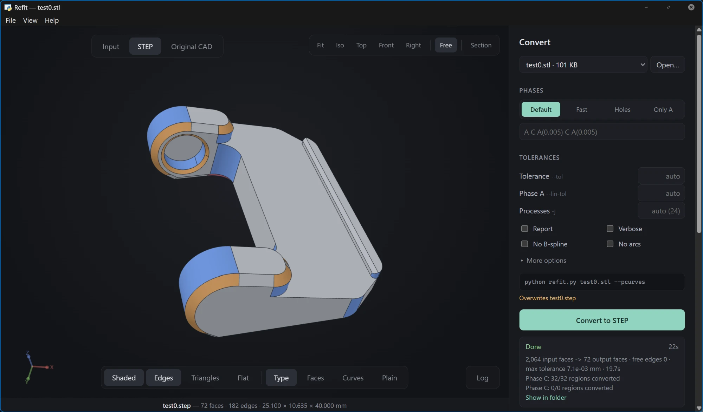

# Refit

**Reconstruction of analytic CAD geometry from triangle meshes.**

Refit converts an STL mesh (or a STEP file that originated from a mesh) into a STEP model made of
true CAD surfaces. Flat regions become planes, holes become cylinders, fillets and chamfers become
fillets and chamfers, and free-form areas become B-spline surfaces, in place of thousands of
triangles.

| Input mesh (2,064 triangles) | Output B-Rep (72 faces) |
| :---: | :---: |
|  |  |

## Features

- **Reliable output.** Every modification is local and verified immediately: the solid must remain
  closed and valid, with consistent orientation and with area and volume matching the mesh. A
  modification that fails the check is discarded, so the result is always a consistent model.
- **Geometric fidelity.** The output stays within a tight tolerance of the source mesh, and
  bundled quality tools report the measured deviation.
- **Feature recognition.** Holes, fillets, chamfers, countersinks, spheres, bosses, threads and
  embossed or engraved text are identified and given their exact surface.
- **Automatic mesh repair.** Holes, duplicate and degenerate triangles, non-manifold edges and
  inconsistent orientation are detected and repaired before conversion, without moving vertices.
- **Integrated viewer.** A desktop application displays the input mesh, the converted model and
  the original CAD side by side, with faces colored by surface type.
- **Parallel execution.** All CPU cores are used, and the result is identical regardless of the
  number of processes.

## Installation

Requires Python 3.9 or later.

```bash
pip install cadquery-ocp numpy scipy pymeshlab
```

`pymeshlab` is optional and enables automatic mesh repair. The viewer additionally requires
`pywebview`:

```bash
pip install pywebview
```

If `import OCP` fails with "DLL load failed", install the matching version of VTK
(`pip install vtk==9.6.2`).

## Usage

Convert a mesh:

```bash
python refit.py part.stl
```

The result is written to `part.step`, next to the input file. The `test/` folder contains example
meshes:

```bash
python refit.py test/test0.stl
```

Verify the result against the source mesh:

```bash
python tools/qa.py test/test0.stl test/test0.step
```

Phases, tolerances and all other options are documented in the header of [`refit.py`](refit.py).

## Viewer

Launch the viewer with `Refit Viewer.pyw` (double-click) or:

```bash
python viewer/server.py
```

The viewer allows selecting a mesh, running the conversion and inspecting the result. The type,
radius and area of each face are shown on hover.

## Repository contents

| Path | Description |
| --- | --- |
| [`refit.py`](refit.py) | Converter. |
| [`Refit Viewer.pyw`](Refit%20Viewer.pyw), [`viewer/`](viewer) | Desktop viewer. |
| [`test/`](test) | Example meshes, some with the original CAD file for comparison. |
| [`tools/`](tools) | Quality checks and analysis scripts (`qa.py`, `cadcmp.py`, ...). |
| [`docs/technical.md`](docs/technical.md) | Technical reference: phases, tolerances, mesh repair, output details. |

## License

MIT, see [LICENSE](LICENSE).
